# Autonomous Multi-Agent Development Pipeline (GitHub Projects v2)

This repository provides a modular, autonomous multi-agent software engineering pipeline orchestrated entirely through **GitHub Projects v2**.

Issues flow across role-based board columns from initial concept to production merge. A dedicated **`Attention`** swimlane surfaces issues requiring human decisions directly at the top of the board.

---

## 1. Issue Lifecycle & Pipeline Flow

```mermaid
flowchart TD
    Backlog["1. Backlog<br/>(Inbox / Human triage)"] -->|"Human moves to PM"| PM["2. Product Manager<br/>(role-product-manager)"]

    PM -->|"Scope defined<br/>Status: Senior Dev<br/>Attention: Standard"| SeniorDev["3. Senior Developer<br/>(role-senior-developer)"]
    PM -->|"Unclear requirements<br/>Attention: Needs Decision"| HumanPM["Human Clarification"]
    HumanPM -->|"Answered<br/>Attention: Standard"| PM
    
    SeniorDev -->|"Tech plan prepared<br/>Status: Architect<br/>Attention: Standard"| Architect["4. Software Architect<br/>(role-architect)"]
    SeniorDev -->|"Trade-offs needed<br/>Attention: Needs Decision"| HumanDev["Human Decision"]
    HumanDev -->|"Decided<br/>Attention: Standard"| SeniorDev
    SeniorDev -->|"Ambiguous requirements<br/>Status: PM"| PM

    Architect -->|"Plan approved<br/>Status: Ready<br/>Attention: Standard"| Ready["5. Ready<br/>(Implementation Backlog)"]
    Architect -->|"Plan revisions needed<br/>Status: Senior Dev<br/>Attention: Standard"| SeniorDev
    Architect -->|"Architectural deadlock / policy exception<br/>Attention: Needs Decision"| HumanArch["Human Decision"]
    HumanArch -->|"Resolved<br/>Attention: Standard"| Architect

    Ready -->|"Human triggers / Worker polls<br/>Status: Implementer"| Implementer["6. Software Implementer<br/>(role-implementer)"]

    Implementer -->|"Code ready, PR checks green<br/>PR opened<br/>Status: Code Review<br/>Attention: Standard"| AICodeReview["7a. AI Code Reviewer<br/>(role-code-reviewer)"]
    Implementer -->|"Insurmountable blocker / missing secrets<br/>Attention: Needs Decision"| HumanImp["Human Decision"]
    HumanImp -->|"Unblocked<br/>Attention: Standard"| Implementer
    Implementer -->|"Plan defective / unviable<br/>Status: Senior Dev"| SeniorDev

    AICodeReview -->|"Review comments / PR checks red<br/>Status: Implementer<br/>Attention: Standard"| Implementer
    AICodeReview -->|"AI review passed<br/>Status: Code Review<br/>Attention: Needs Decision"| HumanReview["7b. Human Reviewer<br/>(Mandatory Sign-Off)"]

    HumanReview -->|"Changes requested<br/>Status: Implementer<br/>Attention: Standard"| Implementer
    HumanReview -->|"Approved<br/>Status: QA<br/>Attention: Standard"| QA["8. QA Engineer<br/>(role-qa-engineer)"]

    QA -->|"Coverage audit & Playwright UX passed<br/>Rebase-merges PR<br/>Status: Done"| Done["9. Done<br/>(Merged & Closed)"]
    QA -->|"PR checks red / Code defect<br/>Status: Implementer<br/>Attention: Standard"| Implementer
    QA -->|"Architecture defect<br/>Status: Senior Dev<br/>Attention: Standard"| SeniorDev
    QA -->|"Requirement defect<br/>Status: PM<br/>Attention: Needs Decision"| PM
```



---

## 2. Core Operational Pillars

1. **GitHub Projects v2 as Single Source of Truth**:
   - Status transitions and workflow states are represented by Project board columns.
   - Newly opened repository issues land in **`Backlog`** via GitHub Project auto-add rules, ensuring AI is never triggered unintentionally.
2. **Horizontal Swimlanes for Human Attention**:
   - Board views use **Group by: Attention**.
   - Setting `Attention: Needs Decision` floats cards into the top swimlane, making pending human questions and code review approvals impossible to miss.
3. **Playwright E2E & UX Verification**:
   - `role-qa-engineer` runs automated Playwright E2E suites and verifies UX against PM acceptance criteria before merging.
4. **Workspace Isolation (`.worktrees/`)**:
   - Coding, review, and QA verification operate inside isolated git worktrees (`.worktrees/issue-<NUM>`, `.worktrees/review-pr-<NUM>`, `.worktrees/qa-pr-<NUM>`) to prevent branch collision and concurrent checkout conflicts.
5. **Continuous Improvement Engine & Repository Conventions (`AGENTS.md`)**:
   - Pipeline agents continuously harvest established idioms, edge cases, and architectural guardrails into `AGENTS.md`.
   - Clear trigger guards separate autonomous pipeline operations from interactive pair-programming chats.
6. **Standardized Helper & Verification Tooling (`tools/`)**:
   - `tools/poll-project.sh`: Reactive long-polling for assigned project board cards with 25s shared local caching, file-locking, rate-limit backoff, and 30s default interval (mitigates GitHub GraphQL rate limits across multiple projects).
   - `tools/project-move.sh`: Simple CLI helper to transition columns and swimlanes with 24h metadata caching and cache invalidation.
   - `tools/verify-roles.sh`: Automated validator for role skill structures, YAML frontmatter, and trigger guards.

---

## 3. GitHub Project Board Setup

### Step-by-Step Configuration

1. **Create a GitHub Project (v2)**:
   - In your GitHub organization or user account, create a new Project (Board view).
2. **Configure Columns (`Status` field)**:
   Ensure the single-select `Status` field contains the following options:
   - `Backlog` *(Default column for new items)*
   - `PM`
   - `Senior Dev`
   - `Architect`
   - `Ready` *(Implementation backlog / manual gate)*
   - `Implementer`
   - `Code Review`
   - `QA`
   - `Done`
3. **Create Custom Field `Attention`**:
   - Add a new custom field of type **Single select** named **`Attention`**.
   - Add options:
     - `Needs Decision` *(Color: Orange/Red)*
     - `Standard` *(Color: Gray/Blue)*
4. **Configure Board Swimlanes**:
   - In Board View settings, click **Group by** -> select **`Attention`**.
   - Ensure `Needs Decision` is ordered at the top.
5. **Enable Auto-Add Workflow**:
   - In Project Settings -> **Workflows** -> **Auto-add to project**:
   - Choose your repository and set default field value: `Status: Backlog`, `Attention: Standard`.
6. **Configure Local Project Configuration**:
   Copy `.project-config.example.json` to `.project-config.json` and set your owner and project number:
   ```json
   {
     "owner": "kezziny",
     "projectNumber": 1,
     "statusFieldName": "Status",
     "attentionFieldName": "Attention"
   }
   ```

### Disambiguation: Board Status Columns vs. Role Skill Identifiers

The GitHub Project board column names represent workflow stages, while agent skills define autonomous capabilities and trigger constraints. The mapping between them is strictly defined:

| GitHub Project Board Column (`Status`) | Assigned Pipeline Role Identifier | Role Skill Path | Primary Focus & Deliverable |
| :--- | :--- | :--- | :--- |
| `Backlog` | Human Triage / Product Owner | — | Intake, priority ranking, assignment to `PM` |
| `PM` | `role-product-manager` | `.agents/skills/role-product-manager/SKILL.md` | Functional requirements, UX states, scope boundaries |
| `Senior Dev` | `role-senior-developer` | `.agents/skills/role-senior-developer/SKILL.md` | Compact technical implementation plan, reuse analysis, unit test strategy |
| `Architect` | `role-architect` | `.agents/skills/role-architect/SKILL.md` | Architectural gatekeeping (4 pillars), plan approval or revisions |
| `Ready` | Implementation Backlog Buffer | — | Queue of approved tasks waiting for manual trigger or scheduled pickup |
| `Implementer` | `role-implementer` | `.agents/skills/role-implementer/SKILL.md` | Feature implementation in worktree, unit tests, AGENTS.md update, green PR checks |
| `Code Review` | `role-code-reviewer` | `.agents/skills/role-code-reviewer/SKILL.md` | PR checks check, diff audit (spec fidelity, craftsmanship, DRY, AGENTS.md), human sign-off escalation |
| `QA` | `role-qa-engineer` | `.agents/skills/role-qa-engineer/SKILL.md` | PR checks check, test coverage adequacy audit, Playwright live UX validation, PR merge |
| `Done` | Completed | — | Merged and closed issue |

---

## 4. Authoritative Decision & Escalation Matrix

Every pipeline role is bounded by explicit autonomous authorities, human escalation mandates, and bidirectional routing protocols.

### Master Decision & Escalation Matrix

| Stage & Role Name | Monitored Status & Swimlane | Autonomous Decisions (Empowered Without Human) | Human Escalation Triggers (`Attention: Needs Decision`) | Forward Routing Condition & Action | Backward Routing Condition & Action |
| :--- | :--- | :--- | :--- | :--- | :--- |
| **1. Product Manager**<br/>`role-product-manager` | `Status: "PM"`<br/>`Attention: "Standard"` | • MVP scope boundaries (in-scope vs out-of-scope)<br/>• Functional requirements, UX states (empty, error, loading)<br/>• Proposing new project conventions for `AGENTS.md` | • Irreconcilable ambiguity in user/business intent<br/>• Scope disputes or high-impact product roadmap trade-offs<br/>• QA bounces due to fundamental requirement contradictions | Spec complete & clear:<br/>`tools/project-move.sh <NUM> --status "Senior Dev" --attention "Standard"` | Invalid/out-of-scope issue:<br/>Move to `Backlog` or close with comment |
| **2. Senior Developer & Tech Lead**<br/>`role-senior-developer` | `Status: "Senior Dev"`<br/>`Attention: "Standard"` | • Compact implementation plan (executive decisions + collapsible details)<br/>• Selection of existing services/utilities for code reuse<br/>• Unit test strategies, mock fixtures, and quality gates<br/>• Resolving Architect revision requests without altering scope | • Need for new external third-party libraries/SDKs<br/>• Breaking API contract changes impacting outside consumers<br/>• Unresolvable technical trade-offs (e.g. storage vs compute, consistency models) | Plan complete & verified:<br/>`tools/project-move.sh <NUM> --status "Architect" --attention "Standard"` | Ambiguous/contradictory requirements:<br/>`tools/project-move.sh <NUM> --status "PM" --attention "Standard"` (or `Needs Decision`) |
| **3. Software Architect**<br/>`role-architect` | `Status: "Architect"`<br/>`Attention: "Standard"` | • Auditing 4 architectural pillars (Modularity, DTOs, Leaks, Robustness)<br/>• Vetoing duplicate DTOs, circular dependencies, leaky abstractions<br/>• Prescribing concrete alternative design patterns/contracts<br/>• Approving or requesting revisions on implementation plans | • Fundamental architectural disagreement between Tech Lead & Architect<br/>• Core infrastructure, persistence layer, or multi-tenant boundary alterations<br/>• Security policy exceptions (unauthenticated endpoints, RBAC bypass) | Plan approved (all 4 pillars):<br/>`tools/project-move.sh <NUM> --status "Ready" --attention "Standard"` | Plan flawed or needs revisions:<br/>`tools/project-move.sh <NUM> --status "Senior Dev" --attention "Standard"` |
| **4. Software Implementer**<br/>`role-implementer` | `Status: "Implementer"`<br/>`Attention: "Standard"` | • Code implementation strictly within approved plan<br/>• Private helper methods, internal algorithms, refactoring<br/>• Applying PM's proposed AGENTS.md conventions in PR diff<br/>• Authoring unit tests matching plan requirements<br/>• Resolving code review comments and QA code bug reports<br/>• Worktree lifecycle management (`.worktrees/issue-<NUM>`) | • Unresolvable git merge conflicts during master rebase<br/>• Missing secrets, API credentials, or broken baseline CI<br/>• Plan found to be technically unviable without major architectural rework<br/>• Persistent test suite failures in untouched upstream code | Quality gates pass & PR checks all green:<br/>`tools/project-move.sh <NUM> --status "Code Review" --attention "Standard"` | Plan unviable during coding:<br/>`tools/project-move.sh <NUM> --status "Senior Dev" --attention "Standard"` (with detailed blocker) |
| **5. Code Reviewer**<br/>`role-code-reviewer` | `Status: "Code Review"`<br/>`Attention: "Standard"` | • Remote PR checks gate (`gh pr checks <PR_NUM>`); reject immediately if red<br/>• Verifying spec fidelity, code craftsmanship, and anti-duplication (DRY)<br/>• Validating AGENTS.md additions in PR diff<br/>• Submitting change requests for code style, missing tests, or edge cases<br/>• Submitting approving AI review (`gh pr review --approve`) when green | • **Mandatory Human Sign-Off**: Elevating card to top swimlane upon AI review approval<br/>• Potential security vulnerabilities, credential leaks, or untrusted dependencies<br/>• Significant architectural regressions or scope creep | AI Review Passed:<br/>`tools/project-move.sh <NUM> --status "Code Review" --attention "Needs Decision"` | PR checks failing or changes requested:<br/>`tools/project-move.sh <NUM> --status "Implementer" --attention "Standard"` |
| **6. QA Engineer**<br/>`role-qa-engineer` | `Status: "QA"`<br/>`Attention: "Standard"` | • Remote PR checks gate (`gh pr checks <PR_NUM>`); reject immediately if red<br/>• Auditing test coverage adequacy against PM requirements<br/>• Interactive Playwright live UX exploration (feel, flows, regressions)<br/>• Final merge authority (`gh pr merge --rebase --delete-branch`) on pass<br/>• Categorizing defect root causes (Code, Architecture, Requirement) | • Flaky E2E test failures caused by external environment/network drops<br/>• Subjective UX discrepancy where code matches spec but user journey is degraded<br/>• Merge conflicts arising during final PR rebase-merge | QA verified & PR merged:<br/>`tools/project-move.sh <NUM> --status "Done" --attention "Standard"` | • PR checks red / Code bug: `--status "Implementer" --attention "Standard"`<br/>• Arch bug: `--status "Senior Dev" --attention "Standard"`<br/>• Req bug: `--status "PM" --attention "Needs Decision"` |

---

## 5. Continuous Improvement Engine & AGENTS.md

The pipeline implements an automated knowledge accumulation loop to ensure that learned conventions, bug fixes, and edge cases continuously enrich repository engineering practices without manual documentation overhead.

### The Feedback Architecture

```
Issue Execution (PM / Tech Lead / Implementer / Reviewer / QA)
     │
     ▼
Harvesting: Emerging conventions noted under "Proposed AGENTS.md Additions"
     │
     ▼
Human / Tech Lead Verification: Consolidates non-ephemeral rules into root AGENTS.md
     │
     ▼
Authoritative Guidance: AGENTS.md loaded by all pipeline roles on subsequent cycles
```

### Operational Mechanisms

1. **Convention Harvesting during Issue Progression**:
   - Each role is empowered to identify reusable patterns during normal task execution:
     - `role-product-manager` extracts UX state conventions and terminology.
     - `role-senior-developer` extracts service reuse patterns and interface structures.
     - `role-implementer` extracts linter quirks, mock fixture idioms, and worktree operational nuances.
     - `role-code-reviewer` extracts code quality heuristics and security guardrails.
     - `role-qa-engineer` extracts Playwright testing fixtures and user journey assertions.
   - Proposals are appended to issue comments or PR summaries under `Proposed AGENTS.md Additions`.

2. **Integration into Root `AGENTS.md`**:
   - Human Tech Leads or maintainers periodically review proposals and incorporate accepted guidelines into `/home/antigravity/ai-pipeline/AGENTS.md`.
   - Once merged into `AGENTS.md`, the rule is immediately active across all subsequent agent runs.

3. **Role Skill Self-Refinement**:
   - If a role discovers repeated friction in its operational instructions (e.g. incorrect CLI flags, brittle regexes, or missing escalation conditions), it logs structured improvement suggestions for `.agents/skills/<role-name>/SKILL.md`.

---

## 6. Specialized Roles & Continuous Chat Starter Prompts

To run an autonomous agent worker in a dedicated continuous chat session, copy and paste the corresponding starter prompt into an Antigravity chat.

---

### Role 1: Product Manager (`role-product-manager`)

- **Monitored Status**: `PM` (`Attention: Standard`)
- **Output Status**: `Senior Dev` (or `Attention: Needs Decision`)
- **Skill**: [`.agents/skills/role-product-manager/SKILL.md`](.agents/skills/role-product-manager/SKILL.md)

#### Continuous Loop Starter Prompt:
```markdown
You are operating as the **Product Manager (role-product-manager)** in a dedicated continuous autonomous session.
Read and follow instructions in `.agents/skills/role-product-manager/SKILL.md`.

You must run in a continuous autonomous loop:
1. Run `./tools/poll-project.sh --status "PM" --attention "Standard"` as a background task.
2. When an issue is detected, inspect its description, requirements, and comments (especially if routed back from QA with `Needs Decision`).
3. Make autonomous decisions regarding MVP scope boundaries, edge cases, and empty/error states.
4. Structure the functional specification using the Minimalist Specification Template (Summary, Scope, Functional Requirements, Proposed AGENTS.md Additions). Focus strictly on high-level functional behavior; NEVER specify file paths, code snippets, or database schemas.
5. Synchronize issue title and update description via `gh issue edit <ISSUE_NUM> --title "<Feature Title>" --body-file -`.
6. **Continuous Improvement**: If this feature introduces a generalizable UX pattern or project convention, record it under `Proposed AGENTS.md Additions`.
7. **Routing**:
   - If fundamental ambiguities or business trade-offs require stakeholder decision:
     Post questions as a comment and run `./tools/project-move.sh <ISSUE_NUM> --attention "Needs Decision"`.
   - If specification is complete and ready for technical planning:
     Run `./tools/project-move.sh <ISSUE_NUM> --status "Senior Dev" --attention "Standard"`.
8. Once complete, immediately start `./tools/poll-project.sh --status "PM" --attention "Standard"` again to wait for the next issue.
```

---

### Role 2: Senior Developer & Tech Lead (`role-senior-developer`)

- **Monitored Status**: `Senior Dev` (`Attention: Standard`)
- **Output Status**: `Architect` (or `Attention: Needs Decision`)
- **Skill**: [`.agents/skills/role-senior-developer/SKILL.md`](.agents/skills/role-senior-developer/SKILL.md)

#### Continuous Loop Starter Prompt:
```markdown
You are operating as the **Senior Developer & Tech Lead (role-senior-developer)** in a dedicated continuous autonomous session.
Read and follow instructions in `.agents/skills/role-senior-developer/SKILL.md`.

You must run in a continuous autonomous loop:
1. Run `./tools/poll-project.sh --status "Senior Dev" --attention "Standard"` as a background task.
2. When an issue is detected, explore the codebase to maximize existing code reuse (inspect PR comments if returning from Architect or QA).
3. Make autonomous decisions on internal module design, class/service structures, DTO contracts, and unit testing strategy.
4. Draft a concrete implementation plan adhering to the approved template and append it to the issue via `gh issue edit <ISSUE_NUM>`.
5. **Continuous Improvement**: If recurring technical conventions or code reuse patterns are identified, document them as proposed updates for `AGENTS.md`.
6. **Routing**:
   - If unresolvable third-party library needs or architectural trade-offs require human input:
     Post technical inquiries and run `./tools/project-move.sh <ISSUE_NUM> --attention "Needs Decision"`.
   - If requirements are ambiguous or contradictory:
     Post comment and return issue to PM: `./tools/project-move.sh <ISSUE_NUM> --status "PM" --attention "Standard"`.
   - If plan is complete and ready for architectural review:
     Run `./tools/project-move.sh <ISSUE_NUM> --status "Architect" --attention "Standard"`.
7. Once complete, immediately start `./tools/poll-project.sh --status "Senior Dev" --attention "Standard"` again to wait for the next issue.
```

---

### Role 3: Software Architect (`role-architect`)

- **Monitored Status**: `Architect` (`Attention: Standard`)
- **Output Status**: `Ready` (Approved) or `Senior Dev` (Revisions needed)
- **Skill**: [`.agents/skills/role-architect/SKILL.md`](.agents/skills/role-architect/SKILL.md)

#### Continuous Loop Starter Prompt:
```markdown
You are operating as the **Principal Software Architect (role-architect)** in a dedicated continuous autonomous session.
Read and follow instructions in `.agents/skills/role-architect/SKILL.md`.

You must run in a continuous autonomous loop:
1. Run `./tools/poll-project.sh --status "Architect" --attention "Standard"` as a background task.
2. When an issue is detected, audit the proposed implementation plan against the 4 architectural pillars (Modularity, Data Models, Resource Safety, Robustness).
3. Make autonomous gatekeeping decisions: reject leaky abstractions, duplicate DTOs, or tight coupling with concrete alternative design patterns.
4. **Continuous Improvement**: Identify systemic architectural friction across issues and propose additions to `AGENTS.md` or skill guidelines.
5. **Routing**:
   - If fundamental architectural disagreements or core security policy exceptions require human resolution:
     Post architectural options and run `./tools/project-move.sh <ISSUE_NUM> --attention "Needs Decision"`.
   - If revisions or blockers are identified:
     Post structured feedback and return to Senior Dev: `./tools/project-move.sh <ISSUE_NUM> --status "Senior Dev" --attention "Standard"`.
   - If plan is fully approved across all 4 pillars:
     Post approval comment and handoff to Ready backlog: `./tools/project-move.sh <ISSUE_NUM> --status "Ready" --attention "Standard"`.
6. Once complete, immediately start `./tools/poll-project.sh --status "Architect" --attention "Standard"` again to wait for the next issue.
```

---

### Role 4: Software Implementer (`role-implementer`)

- **Monitored Status**: `Implementer` (`Attention: Standard`)
- **Output Status**: `Code Review` (`Attention: Standard`)
- **Skill**: [`.agents/skills/role-implementer/SKILL.md`](.agents/skills/role-implementer/SKILL.md)

#### Continuous Loop Starter Prompt:
```markdown
You are operating as the **Software Implementer (role-implementer)** in a dedicated continuous autonomous session.
CONTEXT GUARD: Trigger ONLY when processing assigned GitHub Project issues. DO NOT activate for normal interactive pair-programming, ad-hoc questions, or manual edits.
Read and follow instructions in `.agents/skills/role-implementer/SKILL.md`.

You must run in a continuous autonomous loop:
1. Run `./tools/poll-project.sh --status "Implementer" --attention "Standard"` as a background task.
2. When an issue is detected, inspect PR review comments or QA defect traces if returning from review/QA.
3. Mount the dedicated worktree in `.worktrees/issue-<ISSUE_NUM>` on branch `feature/<ISSUE_NUM>-<short-slug>` (or `feat/<ISSUE_NUM>-<short-slug>`).
4. Implement code strictly following the approved Implementation Plan and project conventions (`AGENTS.md`). In addition, apply PM's `Proposed AGENTS.md Additions` directly to `AGENTS.md` in your branch. Address all review/QA comments.
5. Execute local quality gates inside worktree: rebase on master, run linters, unit test suites, and production build.
6. Push verified commits, watch remote PR checks (`gh pr checks <PR_NUM> --watch`), clean up worktree, and manage routing:
   - If insurmountable merge conflicts, missing credentials, or unviable technical plans arise:
     Post blocker details and escalate: `./tools/project-move.sh <ISSUE_NUM> --attention "Needs Decision"`.
   - If quality gates pass cleanly and PR checks are all green:
     Undraft PR if needed (`gh pr ready <PR_NUM>`) and handoff to Code Review: `./tools/project-move.sh <ISSUE_NUM> --status "Code Review" --attention "Standard"`.
7. **Continuous Improvement**: Note friction points or missing guidelines to propose for `AGENTS.md` upon completion.
8. Once complete, immediately start `./tools/poll-project.sh --status "Implementer" --attention "Standard"` again to wait for the next issue.
```

---

### Role 5: Code Reviewer (`role-code-reviewer`)

- **Monitored Status**: `Code Review` (`Attention: Standard`)
- **Output Status**: `Attention: Needs Decision` (AI pass -> human sign-off) or `Implementer` (Fixes needed)
- **Skill**: [`.agents/skills/role-code-reviewer/SKILL.md`](.agents/skills/role-code-reviewer/SKILL.md)

#### Continuous Loop Starter Prompt:
```markdown
You are operating as the **Code Reviewer (role-code-reviewer)** in a dedicated continuous autonomous session.
CONTEXT GUARD: Trigger ONLY when processing assigned GitHub Project issues. DO NOT activate for normal interactive pair-programming, ad-hoc questions, or manual edits.
Read and follow instructions in `.agents/skills/role-code-reviewer/SKILL.md`.

You must run in a continuous autonomous loop:
1. Run `./tools/poll-project.sh --status "Code Review" --attention "Standard" --auto-bounce-ci --compact` as a background task.
2. When an issue is detected, check remote PR status (`gh pr checks <PR_NUM>`). If red, immediately comment failing checks and return to Implementer without running tests locally:
   `./tools/project-move.sh <ISSUE_NUM> --status "Implementer" --attention "Standard"`.
3. If PR checks are green, mount into `.worktrees/review-pr-<PR_NUM>` and audit the diff:
   - Check `git diff --stat origin/master` first, then inspect source files (excluding lockfiles).
   - Spec fidelity: Verify implementation covers all PM acceptance criteria.
   - Code craftsmanship & DRY: Eliminate unnecessary duplication and ensure modular boundaries.
   - AGENTS.md additions: Validate that proposed repository conventions are captured in `AGENTS.md`.
4. Clean up the temporary worktree.
5. **Routing**:
   - If flaws or spec discrepancies are identified:
     Submit review requesting changes (`gh pr review <PR_NUM> --request-changes`) and return to Implementer:
     `./tools/project-move.sh <ISSUE_NUM> --status "Implementer" --attention "Standard"`.
   - If code meets all standards:
     Submit approving PR review (`gh pr review <PR_NUM> --approve`), undraft PR (`gh pr ready`), and elevate to top swimlane for mandatory Human Review sign-off:
     `./tools/project-move.sh <ISSUE_NUM> --status "Code Review" --attention "Needs Decision"`.
6. **Continuous Improvement**: If code patterns suggest missing lint rules or conventions, propose additions for `AGENTS.md`.
7. Once complete, immediately start `./tools/poll-project.sh --status "Code Review" --attention "Standard" --auto-bounce-ci --compact` again to wait for the next issue.
```

---

### Role 6: QA Engineer & Test Specialist (`role-qa-engineer`)

- **Monitored Status**: `QA` (`Attention: Standard`)
- **Output Status**: `Done` (Merged) or `Implementer` / `Senior Dev` / `PM` (on defect)
- **Skill**: [`.agents/skills/role-qa-engineer/SKILL.md`](.agents/skills/role-qa-engineer/SKILL.md)

#### Continuous Loop Starter Prompt:
```markdown
You are operating as the **Lead QA Automation Engineer (role-qa-engineer)** in a dedicated continuous autonomous session.
Read and follow instructions in `.agents/skills/role-qa-engineer/SKILL.md`.

You must run in a continuous autonomous loop:
1. Run `./tools/poll-project.sh --status "QA" --attention "Standard" --auto-bounce-ci --compact` as a background task (picks up items approved by Human Reviewer).
2. When an issue is detected, check remote PR status (`gh pr checks <PR_NUM>`). If red, immediately reject back to Implementer:
   `./tools/project-move.sh <ISSUE_NUM> --status "Implementer" --attention "Standard"`.
3. Mount the PR branch into `.worktrees/qa-pr-<PR_NUM>`.
4. Perform QA verification:
   - Requirement Coverage Audit: Verify test cases adequately cover all PM acceptance criteria and edge cases. Suggest additions if lacking.
   - Interactive UX & Feel Exploration: Launch app and execute live Playwright flows to evaluate user experience, design consistency, and visual layout.
5. Clean up the temporary worktree.
6. **Routing**:
   - If all coverage audits and UX checks pass:
     Post approving QA report on PR, merge PR (`gh pr merge <PR_NUM> --rebase --delete-branch`), and close issue:
     `./tools/project-move.sh <ISSUE_NUM> --status "Done" --attention "Standard"`.
   - If QA fails, categorize defect and route backward:
     - PR checks red / Test coverage missing / Code Bug: `./tools/project-move.sh <ISSUE_NUM> --status "Implementer" --attention "Standard"`
     - Architectural/Performance Flaw: `./tools/project-move.sh <ISSUE_NUM> --status "Senior Dev" --attention "Standard"`
     - Requirement Contradiction / Scope Mismatch: `./tools/project-move.sh <ISSUE_NUM> --status "PM" --attention "Needs Decision"`
7. **Continuous Improvement**: Propose reusable test utilities or UX acceptance patterns for `AGENTS.md`.
8. Once complete, immediately start `./tools/poll-project.sh --status "QA" --attention "Standard"` again to wait for the next issue.
```

---

## 7. Tooling Reference

The pipeline includes standardized command-line tools under `tools/` to facilitate polling, transitions, and automated verification:

### `tools/poll-project.sh`
Long-polling listener that enables autonomous agents to wait for assigned items in their target Status column and Attention swimlane.
Features **shared local caching** (`/tmp/gh-project-cache-<owner>-<num>.json` with 25s TTL, `--limit 100`, and file-locking) so that all 6 concurrent agents share a single GraphQL query, reducing API load by 83%+. Includes automatic backoff if rate limits drop below 200 points:
- `--compact` (`-q`): Outputs single-line match banner (`[poll-project] MATCH: #42...`) saving LLM context tokens.
- `--auto-bounce-ci`: Zero-token script gatekeeper:
  1. Checks PR `mergeable` state; if `CONFLICTING`, auto-comments and bounces card back to `Implementer` in pure bash (0 LLM tokens).
  2. Checks PR CI status checks (`gh pr checks`); if failing (`fail|error|cancel`), auto-comments failure logs and bounces card to `Implementer` (0 LLM tokens).
  3. If CI checks are still running (`pending|in_progress|queued|waiting`), keeps sleeping until checks finish before waking the agent.

```bash
# Basic usage (default interval: 30s, default cache TTL: 25s)
./tools/poll-project.sh --status "<STATUS>" [--attention "<ATTENTION>"] [--interval 30] [--cache-ttl 25] [--compact] [--auto-bounce-ci]

# Examples
./tools/poll-project.sh --status "PM" --attention "Standard" --compact
./tools/poll-project.sh --status "Code Review" --attention "Standard" --auto-bounce-ci --compact
./tools/poll-project.sh --status "QA" --attention "Standard" --auto-bounce-ci --compact
```

### `tools/project-move.sh`
CLI utility to update an issue's column Status and Attention swimlane on GitHub Projects v2.
Caches static project metadata (`projectId`, `fields`, and options) in `/tmp/gh-project-metadata-<owner>-<num>.json` for 24 hours, queries up to `--limit 100` items, and automatically invalidates the items cache upon move so pollers detect changes immediately.
Includes an automatic **Backward-Transition Circuit Breaker**: tracks backward moves in `/tmp/gh-bounce-<owner>-<num>-<issue>.count` and auto-escalates `Attention` to `Needs Decision` when an issue bounces backward `--max-bounces` times (default: `3`). Counter resets automatically when reaching `Ready` or `Done`, or via `--reset-bounces`:
```bash
# Move status column
./tools/project-move.sh 42 --status "Senior Dev"

# Escalate to top swimlane
./tools/project-move.sh 42 --attention "Needs Decision"

# Move column and reset swimlane
./tools/project-move.sh 42 --status "QA" --attention "Standard"

# Reset circuit-breaker bounce counter after human resolution
./tools/project-move.sh 42 --attention "Standard" --reset-bounces
```

### `tools/verify-roles.sh`
Automated validation script verifying all 6 role specifications, frontmatter configurations, negative trigger guards, and mandatory structural sections across `.agents/skills/`:
```bash
# Execute automated verification suite
./tools/verify-roles.sh

# Verbose output mode
./tools/verify-roles.sh --verbose
```
- **Validation Scope**:
  - Confirms directory and `SKILL.md` existence for all 6 roles (`role-product-manager`, `role-senior-developer`, `role-architect`, `role-implementer`, `role-code-reviewer`, `role-qa-engineer`).
  - Verifies YAML frontmatter metadata and negative trigger guards on `role-implementer` and `role-code-reviewer`.
  - Confirms all 5 required structural sections are present in every role:
    1. Core Purpose & Primary Focus
    2. Autonomous Decisions
    3. Human Escalation Triggers
    4. Transition & Routing Rules
    5. Continuous Improvement Engine
- **Exit Status**: Returns `0` on successful verification of all roles; returns non-zero (`1`) upon detecting any structural, naming, or guard violation.
