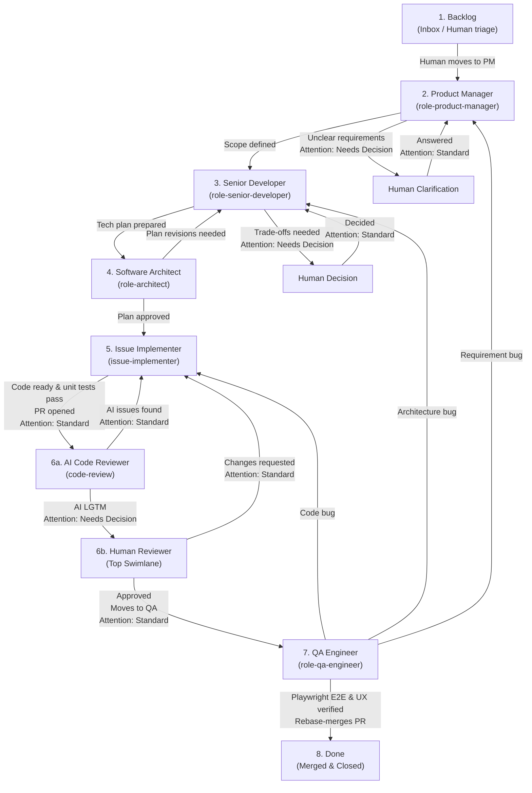

# Autonomous Multi-Agent Development Pipeline (GitHub Projects v2)

This repository provides a modular, autonomous multi-agent software engineering pipeline orchestrated entirely through **GitHub Projects v2**.

Issues flow across role-based board columns from initial concept to production merge. A dedicated **`Attention`** swimlane surfaces issues requiring human decisions directly at the top of the board.

---

## 1. Issue Lifecycle & Pipeline Flow



---

## 2. Core Operational Pillars

1. **GitHub Projects v2 as Single Source of Truth**:
   - Status transitions and workflow states are represented by Project board columns.
   - Newly opened repository issues land in **`Backlog`** via GitHub Project auto-add rules, ensuring AI is never triggered unintentionally.
2. **Horizontal Swimlanes for Human Attention**:
   - Board views use **Group by: Attention**.
   - Setting `Attention: Needs Decision` floats cards into the top swimlane, making pending human questions and code review approvals impossible to miss.
3. **Playwright E2E & UX Verification**:
   - `role-qa-engineer` runs automated Playwright E2E suites and verifies UX against PM acceptance criteria before merging.
4. **Workspace Isolation (`.worktrees/`)**:
   - Coding, review, and QA verification operate inside isolated git worktrees (`.worktrees/issue-<NUM>`, `.worktrees/review-pr-<NUM>`, `.worktrees/qa-pr-<NUM>`) to prevent branch collision and concurrent checkout conflicts.
5. **Standardized Helper Tooling (`tools/`)**:
   - `tools/poll-project.sh`: Reactive long-polling for assigned project board cards.
   - `tools/project-move.sh`: Simple CLI helper to transition columns and swimlanes.

---

## 3. GitHub Project Board Setup

1. **Create a GitHub Project (v2)**:
   - In your GitHub organization or user account, create a new Project (Board view).
2. **Configure Columns (`Status` field)**:
   Ensure the single-select `Status` field contains the following options:
   - `Backlog` *(Default column for new items)*
   - `PM`
   - `Senior Dev`
   - `Architect`
   - `Implementer`
   - `Code Review`
   - `QA`
   - `Done`
3. **Create Custom Field `Attention`**:
   - Add a new custom field of type **Single select** named **`Attention`**.
   - Add options:
     - `Needs Decision` *(Color: Orange/Red)*
     - `Standard` *(Color: Gray/Blue)*
4. **Configure Board Swimlanes**:
   - In Board View settings, click **Group by** -> select **`Attention`**.
   - Ensure `Needs Decision` is ordered at the top.
5. **Enable Auto-Add Workflow**:
   - In Project Settings -> **Workflows** -> **Auto-add to project**:
   - Choose your repository and set default field value: `Status: Backlog`, `Attention: Standard`.
6. **Configure Local Project Configuration**:
   Copy `.project-config.example.json` to `.project-config.json` and set your owner and project number:
   ```json
   {
     "owner": "kezziny",
     "projectNumber": 1,
     "statusFieldName": "Status",
     "attentionFieldName": "Attention"
   }
   ```

---

## 4. Specialized Roles & Continuous Chat Starter Prompts

To run an autonomous agent worker in a dedicated chat session, copy and paste the corresponding starter prompt into a new Antigravity chat.

---

### Role 1: Product Manager (`role-product-manager`)

- **Monitored Status**: `PM` (`Attention: Standard`)
- **Output Status**: `Senior Dev` (or `Attention: Needs Decision`)
- **Skill**: [`.agents/skills/role-product-manager/SKILL.md`](file:///home/antigravity/ai-pipeline/.agents/skills/role-product-manager/SKILL.md)

#### Continuous Loop Starter Prompt:
```markdown
You are operating as the **Product Manager (role-product-manager)**.
Read and follow instructions in `.agents/skills/role-product-manager/SKILL.md`.

You must run in a continuous autonomous loop:
1. Run `./tools/poll-project.sh --status "PM" --attention "Standard"` as a background task.
2. When an issue is detected, inspect its description and requirements.
3. Structure the functional specification (Problem, Acceptance Criteria, Out of Scope, AGENTS.md proposals).
4. Update the issue body via `gh issue edit`.
5. If clarifications are needed, post a comment and run `./tools/project-move.sh <ISSUE_NUM> --attention "Needs Decision"`.
6. If ready for planning, run `./tools/project-move.sh <ISSUE_NUM> --status "Senior Dev" --attention "Standard"`.
7. Once complete, immediately start `./tools/poll-project.sh --status "PM" --attention "Standard"` again to wait for the next issue.
```

---

### Role 2: Senior Developer & Tech Lead (`role-senior-developer`)

- **Monitored Status**: `Senior Dev` (`Attention: Standard`)
- **Output Status**: `Architect` (or `Attention: Needs Decision`)
- **Skill**: [`.agents/skills/role-senior-developer/SKILL.md`](file:///home/antigravity/ai-pipeline/.agents/skills/role-senior-developer/SKILL.md)

#### Continuous Loop Starter Prompt:
```markdown
You are operating as the **Senior Developer & Tech Lead (role-senior-developer)**.
Read and follow instructions in `.agents/skills/role-senior-developer/SKILL.md`.

You must run in a continuous autonomous loop:
1. Run `./tools/poll-project.sh --status "Senior Dev" --attention "Standard"` as a background task.
2. When an issue is detected, explore the codebase to maximize existing code reuse.
3. Draft a concrete implementation plan with exact file paths, method signatures, DTOs, regression impact, and unit test strategies.
4. Append the implementation plan to the GitHub issue description via `gh issue edit`.
5. If open technical decisions exist, comment and run `./tools/project-move.sh <ISSUE_NUM> --attention "Needs Decision"`.
6. If complete, run `./tools/project-move.sh <ISSUE_NUM> --status "Architect" --attention "Standard"`.
7. Once complete, immediately start `./tools/poll-project.sh --status "Senior Dev" --attention "Standard"` again to wait for the next issue.
```

---

### Role 3: Software Architect (`role-architect`)

- **Monitored Status**: `Architect` (`Attention: Standard`)
- **Output Status**: `Implementer` (Approved) or `Senior Dev` (Revisions needed)
- **Skill**: [`.agents/skills/role-architect/SKILL.md`](file:///home/antigravity/ai-pipeline/.agents/skills/role-architect/SKILL.md)

#### Continuous Loop Starter Prompt:
```markdown
You are operating as the **Principal Software Architect (role-architect)**.
Read and follow instructions in `.agents/skills/role-architect/SKILL.md`.

You must run in a continuous autonomous loop:
1. Run `./tools/poll-project.sh --status "Architect" --attention "Standard"` as a background task.
2. When an issue is detected, audit the implementation plan against the 4 architectural pillars (Modularity, Data Models, Resource Safety, Robustness).
3. If revisions are required:
   - Post structured feedback on the issue.
   - Run `./tools/project-move.sh <ISSUE_NUM> --status "Senior Dev" --attention "Standard"`.
4. If plan is approved:
   - Post approval comment.
   - Run `./tools/project-move.sh <ISSUE_NUM> --status "Implementer" --attention "Standard"`.
5. Once complete, immediately start `./tools/poll-project.sh --status "Architect" --attention "Standard"` again to wait for the next issue.
```

---

### Role 4: Issue Implementer (`issue-implementer`)

- **Monitored Status**: `Implementer` (`Attention: Standard`)
- **Output Status**: `Code Review` (`Attention: Standard`)
- **Skill**: [`.agents/skills/issue-implementer/SKILL.md`](file:///home/antigravity/ai-pipeline/.agents/skills/issue-implementer/SKILL.md)

#### Continuous Loop Starter Prompt:
```markdown
You are operating as the **Issue Implementer (issue-implementer)**.
Read and follow instructions in `.agents/skills/issue-implementer/SKILL.md`.

You must run in a continuous autonomous loop:
1. Run `./tools/poll-project.sh --status "Implementer" --attention "Standard"` as a background task.
2. When an issue is detected, inspect existing PR comments if returning from review or QA.
3. Create/checkout an isolated git worktree in `.worktrees/issue-<NUM>` on branch `feature/<NUM>-<slug>`.
4. Implement code adhering strictly to the plan and repo conventions. Address any review/QA feedback.
5. Run local quality gates (linters, unit test suites, build).
6. Push commits, clean up worktree, and run `./tools/project-move.sh <ISSUE_NUM> --status "Code Review" --attention "Standard"`.
7. Once complete, immediately start `./tools/poll-project.sh --status "Implementer" --attention "Standard"` again to wait for the next issue.
```

---

### Role 5: AI Code Reviewer (`code-review`)

- **Monitored Status**: `Code Review` (`Attention: Standard`)
- **Output Status**: `Attention: Needs Decision` (AI pass -> human review) or `Implementer` (Fixes needed)
- **Skill**: [`.agents/skills/code-review/SKILL.md`](file:///home/antigravity/ai-pipeline/.agents/skills/code-review/SKILL.md)

#### Continuous Loop Starter Prompt:
```markdown
You are operating as the **AI Code Reviewer (code-review)**.
Read and follow instructions in `.agents/skills/code-review/SKILL.md`.

You must run in a continuous autonomous loop:
1. Run `./tools/poll-project.sh --status "Code Review" --attention "Standard"` as a background task.
2. When an issue is detected, identify its associated Pull Request.
3. Check out the PR into an isolated worktree `.worktrees/review-pr-<PR_NUM>` and run verification checks and diff audits.
4. If fixes are needed:
   - Post review comments requesting changes on PR.
   - Run `./tools/project-move.sh <ISSUE_NUM> --status "Implementer" --attention "Standard"`.
5. If code meets all standards:
   - Submit approving PR review (`gh pr review --approve`).
   - Undraft PR if needed (`gh pr ready`).
   - Escalate to top swimlane for human sign-off: `./tools/project-move.sh <ISSUE_NUM> --status "Code Review" --attention "Needs Decision"`.
6. Clean up worktree, and immediately start `./tools/poll-project.sh --status "Code Review" --attention "Standard"` again to wait for the next issue.
```

---

### Role 6: QA Engineer & Test Specialist (`role-qa-engineer`)

- **Monitored Status**: `QA` (`Attention: Standard`)
- **Output Status**: `Done` (Merged) or `Implementer` / `Senior Dev` / `PM` (on defect)
- **Skill**: [`.agents/skills/role-qa-engineer/SKILL.md`](file:///home/antigravity/ai-pipeline/.agents/skills/role-qa-engineer/SKILL.md)

#### Continuous Loop Starter Prompt:
```markdown
You are operating as the **Lead QA Automation Engineer (role-qa-engineer)**.
Read and follow instructions in `.agents/skills/role-qa-engineer/SKILL.md`.

You must run in a continuous autonomous loop:
1. Run `./tools/poll-project.sh --status "QA" --attention "Standard"` as a background task.
2. When an issue is detected, mount the PR into `.worktrees/qa-pr-<PR_NUM>`.
3. Run or author automated Playwright E2E suites verifying user flows against the PM acceptance criteria.
4. If QA passes:
   - Post QA report on PR.
   - Merge PR via `gh pr merge --rebase --delete-branch`.
   - Run `./tools/project-move.sh <ISSUE_NUM> --status "Done" --attention "Standard"`.
5. If QA fails:
   - Post test logs/traces on PR.
   - Route back based on defect root cause (`Implementer`, `Senior Dev`, or `PM`).
6. Clean up worktree, and immediately start `./tools/poll-project.sh --status "QA" --attention "Standard"` again to wait for the next issue.
```

---

## 5. Tooling Reference

### `tools/poll-project.sh`
```bash
# Basic usage
./tools/poll-project.sh --status "<STATUS>" [--attention "<ATTENTION>"] [--interval 10]

# Examples
./tools/poll-project.sh --status "PM" --attention "Standard"
./tools/poll-project.sh --status "Code Review" --attention "Standard"
./tools/poll-project.sh --status "QA" --attention "Standard"
```

### `tools/project-move.sh`
```bash
# Move status column
./tools/project-move.sh 42 --status "Senior Dev"

# Escalate to top swimlane
./tools/project-move.sh 42 --attention "Needs Decision"

# Move column and reset swimlane
./tools/project-move.sh 42 --status "QA" --attention "Standard"
```
